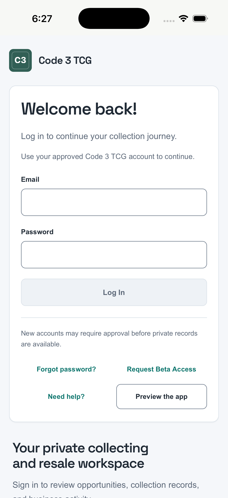

# First iPhone cloud build — passed

The native updates were committed and pushed to `codex/all-bot-integration-setup` as [`890b9dc`](https://github.com/zafthegreat-cyber/ember-ledger/commit/890b9dc214861c5b1e3bfb62bce0a8c93f654aa4). The first [Native beta build checks run](https://github.com/zafthegreat-cyber/ember-ledger/actions/runs/39153535141) completed successfully on October 18, 2026, at approximately **2:27 PM America/New_York**.

The production branch remained `main` at `3a1ca40a4bede9fb4ca41c64905ea409c2c43c07`. No merge, production deployment, migration, account mutation, signing-secret upload or store upload was performed. The native commit changes no generated price files and retains price commit `89da91d1b1ae229097d0203f568ae240f0f33242`. Existing account data and device storage were not accessed by the cloud smoke test.

## Observed result

| Check | Result |
| --- | --- |
| Runner | GitHub-hosted `macos-26`, Apple Silicon |
| Xcode | 26.6, build 17F113 |
| Simulator | Newly created, empty iPhone 17, iOS 26.5 |
| Dependency installation | `npm ci` passed |
| Native JavaScript regressions | 19 bridge/lifecycle scenarios plus App export behavior tests passed |
| Native web bundle and platform sync | Passed, with account services deliberately unconfigured |
| Swift/Objective-C/project compilation | `xcodebuild` reported `BUILD SUCCEEDED` |
| Install and launch | `app.code3tcg.mobile` installed and launched successfully |
| Immediate crash check | The expected app process remained alive after the five-second check |
| Visible UI | Screenshot inspected: Code 3 TCG sign-in page is rendered, with the header below the system status area |
| Artifact | Downloaded and SHA-256 verified; the archived `App.app/App` retains Unix mode `755` |
| Cleanup | Only the disposable simulator created by this run was shut down and deleted |

The unsigned simulator app is not an iPhone-installable IPA or TestFlight build. No sign-in, account sync, Keychain persistence, camera, location, file sharing, account deletion or physical-device acceptance was exercised. The disabled Log In button in the screenshot has empty fields; no credentials were entered. A screenshot and process-survival check are not end-to-end UI tests.

Machine-readable evidence: [simulator result](./evidence/ios-first-cloud-result.json). The `uploaded: false` field means no store upload; the CI evidence artifact itself was uploaded to this GitHub workflow run.

## Artifact and logs

- [GitHub build artifact](https://github.com/zafthegreat-cyber/ember-ledger/actions/runs/39153535141/artifacts/12145819797): `code3-ios-simulator-smoke-not-for-testflight`, 5,990,326 bytes; expires October 25, 2026 under the seven-day retention setting.
- Artifact SHA-256: `dc0c3a0e59958ba9558fb80b0b58f11a5fffad4316b0ff34512718543baf4a45`.
- Local retained archive: `artifacts/native/code3-ios-first-cloud-build.zip`.
- Extracted local evidence and simulator app ZIP: `artifacts/native/first-ios-cloud/`.
- Detailed job steps and logs: [iOS simulator job](https://github.com/zafthegreat-cyber/ember-ledger/actions/runs/39153535141/job/117751912373).

Non-failing warnings: Xcode selected the first matching simulator architecture; App Intents metadata extraction was skipped because the app has no AppIntents dependency. GitHub forced the version-4 actions onto Node 24 and reported their Node 20 deprecation. The run still passed; these are recorded rather than treated as additional acceptance tests.

## Next gates

Complete the LLC's Apple Developer enrollment after D-U-N-S issuance, configure protected distribution signing, and produce a signed TestFlight build. Finish the staged privacy/deletion and native API/auth configuration described in the [readiness checklist](./READINESS.md), then test the real iPhone and Android phone. Keep the original PWA and verified transfer files until the actual devices' records and attachments have been compared.
